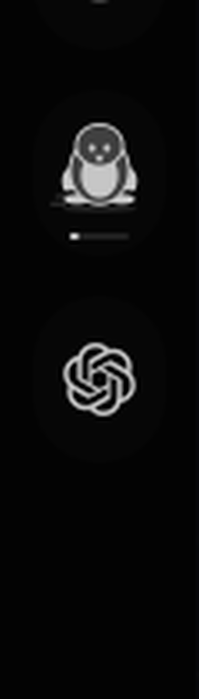
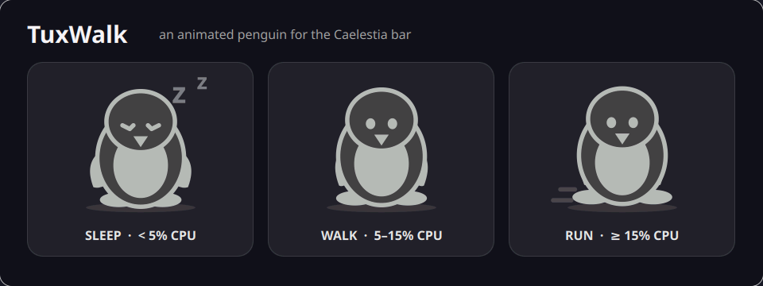

# TuxWalk 🐧 for Caelestia

A small animated CPU penguin for Caelestia's taskbar, drawn as theme-coloured vectors.
Supports left, right, top and bottom bars. Shares Caelestia's native CPU service;
no extra monitoring process, downloaded sprites, or dependencies.

The penguin breathes while sleeping, waddles while walking, and bounds
with a faster stride while running. Hover for the current activity and CPU load.



This is TuxWalk on my actual Caelestia bar. The enlarged preview below shows the three animated states drawn by the same QML component.



[Watch the animation demo](media/tuxwalk-demo.mp4)

| CPU load | Animation |
| --- | --- |
| Below 5% | Sleeping with floating z's |
| 5% to below 15% | Walking |
| 15% and above | Running |

Load is smoothed once per second. A sleeping penguin wakes at 6%; a running penguin
slows below 14%. These small dead bands prevent flicker around the thresholds.
Edit `components/TuxMotion.js` to change the boundaries and reinstall.

## Install

```sh
git clone https://github.com/Nazar1Kazakov/tuxwalk.git
cd tuxwalk
python3 install.py
caelestia shell -r -d
```

You can download the repository as a ZIP instead of cloning it; extract the ZIP first.
Requires an existing Caelestia shell installation
and Python 3. The installer does not restart the shell automatically.

The installer copies three files into
`~/.config/quickshell/caelestia/modules/bar/components/`, registers the `tuxwalk`
entry in `modules/bar/Bar.qml`, and adds it immediately after the workspaces in
`~/.config/caelestia/shell.json`. It respects `XDG_CONFIG_HOME` and backs up every
file it replaces to `backups/<timestamp>/`. Running it again does not duplicate
the entry or change an existing placement. Restart Caelestia after installing. Shell updates may overwrite the
delegate registration; rerun the installer after an update if needed.
An earlier penguin install is renamed to TuxWalk in place, preserving its bar
position and enabled state.

Move `{"id": "tuxwalk", "enabled": true}` between `bar.entries.start`,
`center`, or `end` in `shell.json` to reposition the penguin; set `enabled` to `false`
to hide it. Per-monitor entry overrides must also include `tuxwalk` if used.

## Preview and validation

`qml6 preview.qml` shows the three animated poses. For an offscreen preview and
CPU transition checks, run `python3 check.py` (requires PySide6 for development
only). This writes `media/preview.png` locally. `media/tuxwalk-on-bar.png` shows the installed widget
on my current desktop.

## Remove

Remove the `tuxwalk` entry from `shell.json` and its `DelegateChoice` block from
`Bar.qml`, then remove the three installed component files and reload. The
initial backups can also restore those files, provided you have made no later
changes you want to keep.
